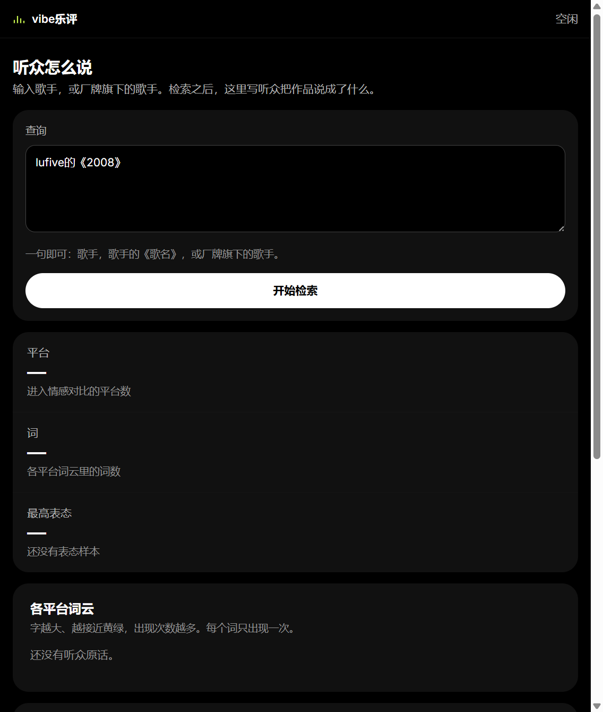
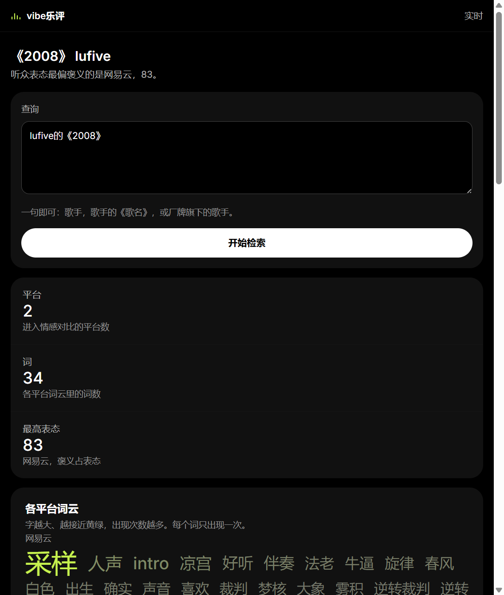
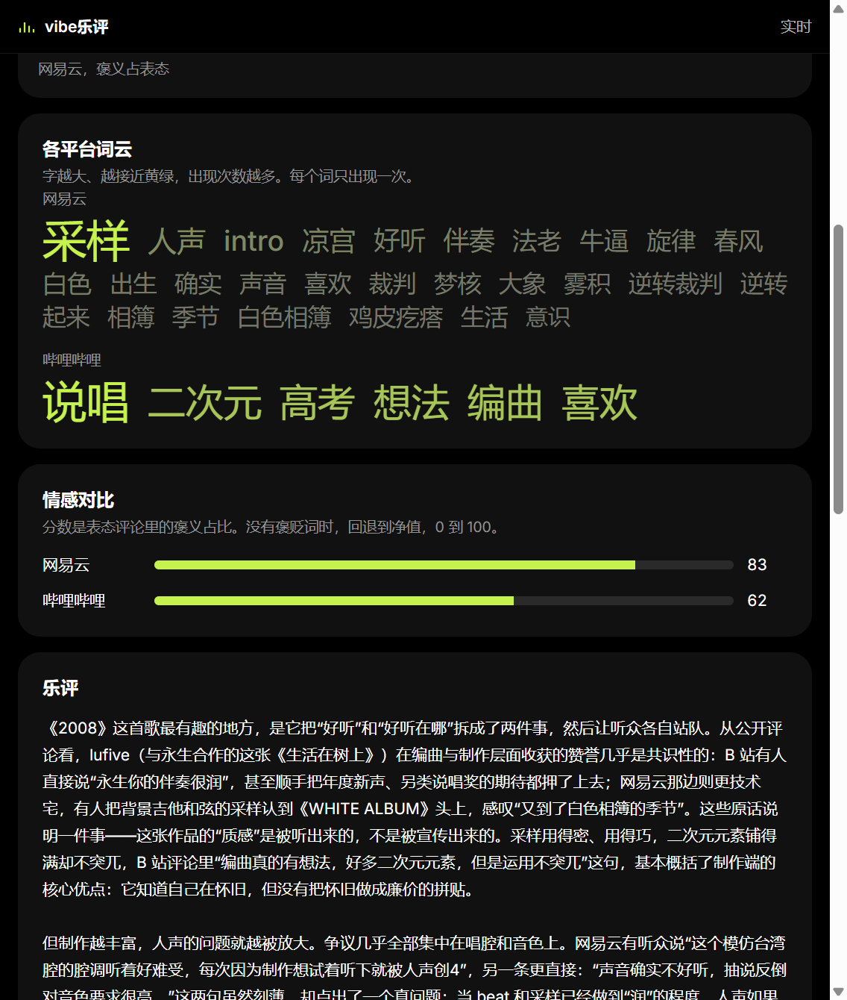
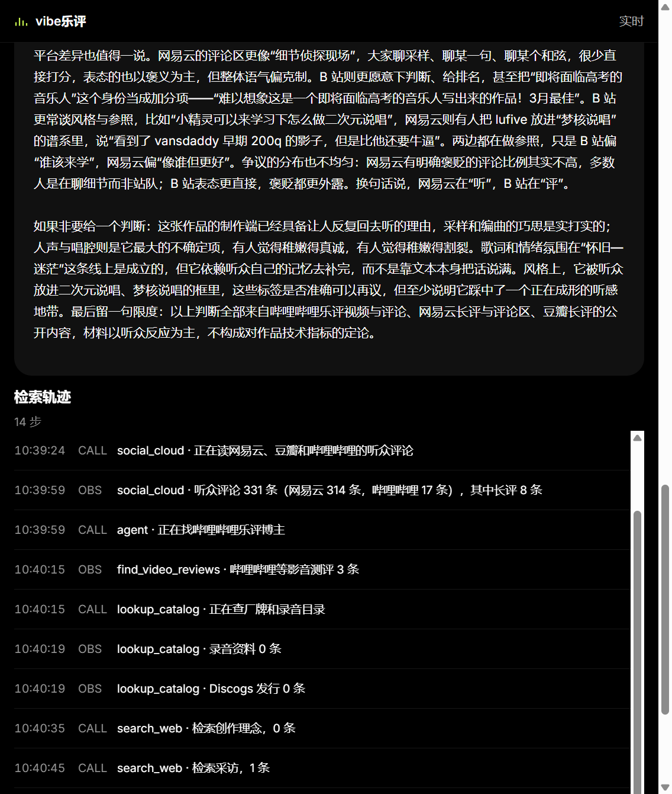

# vibe乐评

单用途 AI Agent：**输入歌手或歌曲**，从网易云、豆瓣、哔哩哔哩等平台抓取**可核对的听众与影音测评材料**，在页面上展示**分平台词云、情感对比**与 **DeepSeek 生成的中文乐评**。结论约束在工具返回内容内，不靠模型记忆填空。

课设要求（Tool Skills + MCP / Function Calling + Vibe Coding 分工）见文末 [合规对照](#课设合规对照)。

---

## 快速开始

### 1. 环境

```bash
git clone https://github.com/<你的用户名>/vibecodingAI.git
cd vibecodingAI
python -m venv .venv
.venv\Scripts\pip install -r requirements.txt
copy .cursor\mcp.json.example .cursor\mcp.json
```

按本机路径修改 `.cursor/mcp.json` 里的 Python 与 `mcp_server.py` 位置（示例文件里是 Windows 绝对路径）。

### 2. 配置模型（AI 乐评必需）

在仓库根目录创建 `.env`（勿提交 git）：

```bash
DEEPSEEK_API_KEY=你的密钥
DEEPSEEK_MODEL=deepseek-chat
```

也支持 OpenAI 兼容接口或本机 Ollama，逻辑见 `src/loop.py` 中 `llm_config()`。

### 3. 启动网页

```bash
.venv\Scripts\python src\web_app.py
```

浏览器打开 **http://127.0.0.1:8765**。

### 4. 输入示例

| 写法 | 含义 |
|------|------|
| `lufive的《2008》` | 歌手 + 歌名 |
| `某厂牌旗下的歌手名` | 带厂牌缩小检索范围 |
| 仅歌手名 | 按艺人整体检索（不查录音目录） |

点击 **开始检索**，右侧 **检索轨迹** 会实时显示工具步骤；完成后主栏展示 KPI、词云、情感与乐评。

### 5. 命令行（可选）

```bash
.venv\Scripts\python src\loop.py --song 2008 --artist lufive
```

报告写入 `src/output/*.md`，同目录 `.context.json` 为当次工具原文。

---

## 界面与功能（带截图）

截图位于 [`docs/readme-screenshots/`](docs/readme-screenshots/)，示例查询为 `lufive的《2008》`。

### 整体布局

- **左侧主栏**：查询 → KPI → 词云 → 情感 → AI 乐评  
- **右侧侧栏**：检索轨迹（CALL / OBS / LLM）  
- 顶栏：**vibe乐评** 品牌 + 状态（空闲 / 执行中 / 实时）



### ① 查询区

- 一句话输入歌手、歌名或「厂牌旗下的歌手」  
- **开始检索** 触发 SSE `/api/ask`，后端 `loop.answer_query` 固定编排调用各 Skill  



| 标注 | 功能 |
|------|------|
| A | 主标题变为《歌名》+ 歌手；副标题概括**听众表态最偏褒义的平台** |
| B | **查询** 文本框与 **开始检索** |
| C | **KPI 条**：参与情感对比的平台数、词云总词数、最高表态分 |

### ② 各平台词云

- 数据来自 Skill **`social_cloud`**（网易评论、豆瓣、B 站评论等；不含微博/知乎）  
- **字号 + 黄绿色** 表示词频；**每个词只出现一次**  



| 标注 | 功能 |
|------|------|
| D | 分平台词云（如网易云、哔哩哔哩） |
| E | **情感对比**：各平台表态评论的褒义占比（0–100）；样本不足时不展示该平台 |

### ③ AI 乐评

- 检索结束后调用 **DeepSeek**（`review_prompt.md` + 材料 JSON）  
- 流式打字展示；强调对听众争议与平台差异的**分析**，而非堆砌统计句  



| 标注 | 功能 |
|------|------|
| F | **乐评** 正文（基于公开评论与检索材料） |
| G | **检索轨迹**：时间戳 + CALL（调工具）/ OBS（返回）/ LLM（写乐评） |

> **可选补拍**：当前截图以纵向滚动为主。若需要一张 **1440px 宽**、**左侧主栏 + 右侧轨迹同屏** 的提交用图，请按 [`docs/readme-screenshots/补拍说明.md`](docs/readme-screenshots/补拍说明.md) 保存为 `06-layout-wide.png`，README 会自动引用（见该文件说明）。

---

## 后端在做什么

一次网页请求的流水线（`src/loop.py` → `research`）：

1. **`social_cloud`** — 听众评论、词云、听众分析、情感/profile  
2. **`find_video_reviews`** — B 站 / 豆瓣 / 抖音影音测评线索  
3. **`lookup_musicbrainz` / `lookup_discogs`** — 有歌名+歌手时查发行目录  
4. **`search_web` + `fetch_page`** — 创作理念、采访、MV 等垂直检索并打开正文  
5. **`write_ai_review`** — 将裁剪后的 JSON 交给大模型写乐评  
6. **`render_digest` + `save_report`** — 写入 `src/output/`

编排由 **Python 循环**完成；CLI 路径另支持 **`summarize()` + function calling** 让模型补调工具（见 `src/prompt.md`）。

---

## 代码结构

| 路径 | 作用 |
|------|------|
| [`src/web/index.html`](src/web/index.html) | 网页工作台（React + SSE） |
| [`src/web_app.py`](src/web_app.py) | Starlette 服务、输入解析 |
| [`src/loop.py`](src/loop.py) | 编排循环、`answer_query`、AI 乐评 |
| [`src/prompt.md`](src/prompt.md) | CLI 综述 system prompt |
| [`src/review_prompt.md`](src/review_prompt.md) | 网页 AI 乐评 system prompt |
| [`src/skills/`](src/skills/) | 各 Skill 实现 + Pydantic 参数 |
| [`src/mcp_server.py`](src/mcp_server.py) | MCP 服务 `music-research` |
| [`.cursor/mcp.json`](.cursor/mcp.json) | Cursor 内 MCP 启动配置 |
| [`docs/ai乐评-有效prompt.md`](docs/ai乐评-有效prompt.md) | 构建过程中的 Vibe Coding 指令整理 |

---

## MCP 与 Cursor

在 Cursor 中启用 MCP 服务器 **music-research** 后，可在对话里直接调用与网页相同的技能（如 `social_cloud`、`search_web`）。启动命令见 `.cursor/mcp.json`。

---

## 课设合规对照

| 要求 | 本项目 |
|------|--------|
| **≥2 个不同 Skill** | `search_web`、`fetch_page`、`social_cloud`、`find_video_reviews`、`lookup_musicbrainz`、`lookup_discogs` 等 |
| **MCP 或 function calling** | MCP：`mcp_server.py`；Function calling：`loop.summarize()` + `openai_tools()` |
| **Vibe Coding** | Skills / MCP / HTTP 样板在 `src/skills`；产品与边界在 **prompt + loop + 网页** |

---

## 更多文档

- 实验记录：[`experiments/EXP_index.md`](experiments/EXP_index.md)  
- 协议参考：[`docs/literature/bibliography.md`](docs/literature/bibliography.md)  
- 目录约定参考实验室仓库 `speedbump_v2`

---

## 截图文件一览

| 文件 | 内容 |
|------|------|
| `01-idle.png` | 未检索时的查询区与空状态 |
| `03-results-top.png` | KPI + 词云（上半屏） |
| `05-sentiment-review.png` | 词云下半 + 情感条 + 乐评开头 |
| `04-trace-and-review.png` | 乐评 + 检索轨迹日志 |
| `02-results-full.png` | 整页长截图（备用） |
