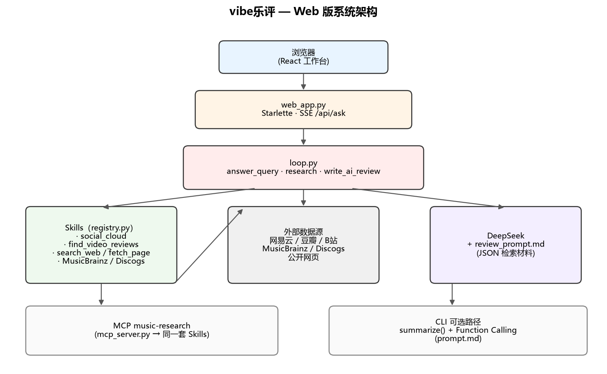

# vibe乐评

**vibe乐评** 是一个面向小众华语音乐的智能体应用：输入**歌手**或**歌曲**后，系统从网易云、豆瓣、哔哩哔哩等公开渠道**抓取听众评论与影音讨论**，在网页上呈现**分平台词云、情感对比**，并生成一篇**可核对材料来源的中文 AI 乐评**。设计原则是结论尽量绑定检索结果，**避免大模型凭训练记忆编造**乐评或百科式背景。

文档结构：[项目概述](#项目概述) · [安装与运行](#安装与运行) · [界面说明](#界面说明) · [处理流程](#处理流程) · [仓库结构](#仓库结构) · [MCP 集成](#mcp-集成) · [课程要求对照](#课程要求对照)

---

## 项目概述

| 能力 | 说明 |
|------|------|
| 多平台听众声音 | 汇总评论文本，提取高频词与情感倾向 |
| 结构化呈现 | 词云、平台间情感分数、检索过程时间线 |
| AI 乐评 | 在材料范围内归纳观点、争议与平台差异 |
| 可核对性 | 轨迹日志展示工具调用；缺材料时明确标注「未找到」 |
| 小众场景 | 支持「厂牌 + 歌手」等输入，缩小检索范围；不依赖百科式科普 |

**范围边界：** 不包含微博/知乎听众流；不虚构外国专业机构乐评；不把豆瓣短评直接当作权威定论；默认不上传或分析本地音频（听音模块需单独配置）。

---

## 安装与运行

### 获取代码与依赖

```bash
git clone https://github.com/uckzkky/vibecodingAI.git
cd vibecodingAI
python -m venv .venv
.venv\Scripts\pip install -r requirements.txt
```

Mac/Linux 将 `.venv\Scripts\` 换为 `.venv/bin/`。

### 配置大模型（AI 乐评）

1. 复制 `.env.example` 为 `.env`（勿提交至 Git）。  
2. 在 [DeepSeek 开放平台](https://platform.deepseek.com/) 申请 API Key 并写入：

```bash
DEEPSEEK_API_KEY=你的密钥
DEEPSEEK_MODEL=deepseek-chat
```

未配置密钥时，网页仍执行检索并展示词云与情感；**乐评**区域会提示无法生成正文。亦支持 OpenAI 兼容接口或本机 Ollama，见 `src/loop.py` 中 `llm_config()`。

### 启动 Web 界面

```bash
.venv\Scripts\python src\web_app.py
```

浏览器访问 **http://127.0.0.1:8765**。

### 查询输入格式

| 输入示例 | 解析结果 |
|----------|----------|
| `lufive的《2008》` | 歌手 lufive，歌名 2008 |
| `某厂牌旗下的某歌手` | 厂牌语境 + 歌手（可选带歌名） |
| 仅歌手名 | 按艺人整体检索（不查全球发行目录） |

点击 **开始检索**。单次检索通常约 **1～3 分钟**；右侧 **检索轨迹** 同步更新。

### Cursor MCP（可选）

```bash
copy .cursor\mcp.json.example .cursor\mcp.json
```

将其中 Python 与 `mcp_server.py` 路径改为本机实际路径，见 [MCP 集成](#mcp-集成)。

### 命令行报告（可选）

```bash
.venv\Scripts\python src\loop.py --song 2008 --artist lufive
```

Markdown 报告写入 `src/output/`（已在 `.gitignore` 中排除，不进入版本库）。

---

## 界面说明

示例截图目录：[`docs/readme-screenshots/`](docs/readme-screenshots/)（示例查询 `lufive的《2008》`）。

### 布局

- **主栏（左）**：查询 → 概览数字 → 词云 → 情感对比 → AI 乐评  
- **侧栏（右）**：检索轨迹（按时间记录工具调用与模型步骤）  
- **顶栏**：产品标识与运行状态（就绪 / 检索中 / 实时更新）


### 查询区

文本框接受一句话查询；点击 **开始检索** 后，系统解析歌手、歌名及厂牌（如输入「厂牌旗下的歌手」句式）。


| 界面元素 | 含义 |
|----------|------|
| 主标题 | 当前歌名与歌手 |
| 标题下摘要 | 各平台中整体更偏正面的听众平台及情感分 |
| 概览三数 | **平台**：参与情感对比的平台数；**词**：词云不重复词数；**最高表态**：褒义倾向最高的平台与分数 |

### 各平台词云

从听众评论中提取高频词：**字号越大、颜色越亮（黄绿）** 表示出现越频繁；每个词仅显示一次。数据来自网易云、豆瓣、哔哩哔哩等（不含微博、知乎）。


### 情感对比

各平台 0～100 分，表示「含明确褒贬态度的评论中，褒义占比的估计值」。评论量不足或情感词过少时，该平台可能不出现，属正常统计结果。

### AI 乐评

检索完成后，大模型基于评论摘要、争议与平台差异撰写中文乐评（流式显示）。材料不足时正文会说明依据有限。乐评为辅助阅读，不替代对作品本身的独立判断。


### 检索轨迹标记

| 标记 | 含义 |
|------|------|
| **CALL** | 正在调用某项技能（如读取平台评论） |
| **OBS** | 技能返回的结果摘要 |
| **LLM** | 大模型在规划或撰写乐评 |

轨迹与材料 JSON 共同说明：**输出可追溯至工具结果，而非无依据生成**。

---

## 系统架构



浏览器通过 SSE 调用 `web_app.py`，由 `loop.py` 编排多项 Skills 抓取外部数据；整理后的 JSON 与 `review_prompt.md` 一并交给 DeepSeek 生成乐评。同一套 Skills 亦可通过 MCP（`music-research`）或命令行 Function Calling 调用。

重新生成架构图：`.venv\Scripts\python tools\draw_architecture.py`

---

## 处理流程

单次 Web 请求的执行顺序：

1. **`social_cloud`** — 听众评论、词云、听众分析、分平台情感  
2. **`find_video_reviews`** — 哔哩哔哩、豆瓣、抖音等影音测评线索  
3. **`lookup_musicbrainz` / `lookup_discogs`** — 同时具备歌名与歌手时查询发行目录  
4. **`search_web` + `fetch_page`** — 创作理念、采访、MV 等垂直检索与正文抽取  
5. **`write_ai_review`** — 将裁剪后的 JSON 提交 DeepSeek（规则见 `src/review_prompt.md`）  
6. **`render_digest` + `save_report`** — 可选写入 `src/output/`

Web 主路径由 `src/loop.py` 中的 **编排循环** 按固定顺序调用技能。命令行路径另支持 **`summarize()` + Function Calling**，由模型在材料不足时补调工具（见 `src/prompt.md`）。

---

## 仓库结构

| 路径 | 说明 |
|------|------|
| `src/web/index.html` | Web 工作台前端 |
| `src/web_app.py` | HTTP 服务与输入解析 |
| `src/loop.py` | 编排循环、AI 乐评入口 |
| `src/review_prompt.md` | 网页乐评 system prompt |
| `src/prompt.md` | 命令行综述 system prompt |
| `src/skills/` | 技能实现与 Pydantic 参数 |
| `src/mcp_server.py` | MCP 服务 `music-research` |
| `docs/ai乐评-有效prompt.md` | 开发阶段产品指令与迭代记录 |

---

## MCP 集成

**MCP（Model Context Protocol）** 将本项目的 Python 技能注册为 Cursor 可调用的工具，行为与 Web 检索使用的技能一致。

1. 从 `mcp.json.example` 复制为 `.cursor/mcp.json` 并修正路径。  
2. 在 Cursor 中启用 MCP 服务器 **music-research**。  
3. 对话中可调用 `social_cloud`、`search_web` 等做调试或扩展实验。

---

## 课程要求对照

| 要求 | 实现 |
|------|------|
| ≥2 个不同 Skill | `search_web`、`fetch_page`、`social_cloud`、`find_video_reviews`、`lookup_musicbrainz`、`lookup_discogs` 等 |
| MCP 或 Function Calling | MCP：`mcp_server.py`；Function Calling：`summarize()` + `openai_tools()` |
| Vibe Coding 分工 | 样板代码在 `src/skills/`；产品与编排于 `prompt.md`、`loop.py`、Web |

---

## 附录

### 离线部署包

目录 [`dist/`](dist/) 中的 **`vibecodingAI-deploy.zip`** 为可分发压缩包（含源码与文档，不含 `.venv`、`.env`、Git 与本地运行报告）。解压后阅读包内 **`DEPLOY.txt`**。需要重新打包时执行：

```bash
.venv\Scripts\python tools\pack_deploy.py
```

- 协议与 API：[`docs/literature/bibliography.md`](docs/literature/bibliography.md)  
- 迭代指令记录：[`docs/ai乐评-有效prompt.md`](docs/ai乐评-有效prompt.md)  
- 宽屏截图说明：[`docs/readme-screenshots/补拍说明.md`](docs/readme-screenshots/补拍说明.md)

### 截图索引

| 文件 | 内容 |
|------|------|
| `01-idle.png` | 检索前界面 |
| `03-results-top.png` | 概览与词云（上部） |
| `05-sentiment-review.png` | 词云、情感、乐评开头 |
| `04-trace-and-review.png` | 乐评与轨迹 |
| `02-results-full.png` | 整页长图 |
